# Native bulk ingestion

`polygraph_bulk_import` is a standalone C++23 preparation and native import tool. It does not link the BFS coordinator, query execution, servers, or GPU runtime. Legacy `tools/polygraph.py load` is unchanged.

## Build and first preparation

```bash
cmake --preset cpu-tests
cmake --build --preset cpu-tests --target polygraph_bulk_import polygraph_ingestion_test
build/cpu-tests/bin/polygraph_bulk_import --help

build/cpu-tests/bin/polygraph_bulk_import prepare \
  --adapter ldbc-snb \
  --input tests/fixtures/ingestion/raw \
  --placement-config tests/fixtures/ingestion/placement.json \
  --partitioner none \
  --output-dir build/bulk-example/raw \
  --threads 8 --memory-limit-mb 2048

build/cpu-tests/bin/polygraph_bulk_import verify \
  --manifest build/bulk-example/raw/manifest.json --strict

build/cpu-tests/bin/polygraph_bulk_import prepare \
  --adapter polygraph-jsonl \
  --input tests/fixtures/ingestion/canonical.jsonl \
  --placement-config tests/fixtures/ingestion/placement.json \
  --output-dir build/bulk-example/canonical
```

Preparation never accesses a live database, starts a container, or invokes an importer. Use an immutable input directory outside the output directory. Generated artifacts and benchmarks belong under ignored `build/` or `out/` paths.

`POLYGRAPH_BUILD_BULK_IMPORT=ON` enables the library and CLI (enabled in `cpu-tests`). Dependencies are SQLite3 and OpenSSL, plus the existing vendored JSON and GlobalId codec. `POLYGRAPH_INGESTION_NATIVE_EXECUTORS=ON` detects libpq/libcurl; without those libraries preparation and artifact verification remain usable and unavailable execution paths fail explicitly. To build independently of runtime applications:

```bash
cmake -S . -B build/ingestion-only -G Ninja \
  -DPOLYGRAPH_ENABLE_GPU=OFF -DPOLYGRAPH_BUILD_BACKENDS=OFF \
  -DPOLYGRAPH_BUILD_BFS=OFF -DPOLYGRAPH_BUILD_HTTP=OFF \
  -DPOLYGRAPH_BUILD_TESTS=OFF -DPOLYGRAPH_BUILD_BULK_IMPORT=ON \
  -DPOLYGRAPH_ENABLE_CLANG_FORMAT=OFF -DPOLYGRAPH_ENABLE_CLANG_TIDY=OFF
cmake --build build/ingestion-only --target polygraph_bulk_import
```

## Data flow and extension points

```mermaid
flowchart LR
  A[Streaming JSONL or CsvBasic adapter] --> N[Normalize properties and placement]
  N --> P[Optional external partition mapping]
  P --> I[Assign or validate canonical IDs]
  I --> D[(SQLite node and edge index)]
  D --> R[Resolve endpoints and adjacency replicas]
  R --> W[Independent backend writers]
  W --> M[Atomic artifacts and SHA-256 manifest]
  M --> V[Offline verification]
  V --> E[Explicit native execution]
  E --> L[Exact live ID and endpoint checks]
```



Reusable interfaces live in `include/ingestion/Import.hpp`. `IGraphInputAdapter` streams nodes and then relationships to a record consumer. A future Parquet adapter implements these two passes and metadata without changing the planner or backend writers. `Placement` validates typed backend routes; the LDBC assigner implements the Python block31 conventions. The SQLite index separates identity, graph records, adjacency replicas and deduplicated proxy sets. Writers own their read connections and buffered files. `IImportExecutor` and an injectable `ExecutorFactory` separate native execution from lifecycle orchestration and allow service-free failure/concurrency tests.

The library uses exceptions of type `ingestion::Error` for domain failures and RAII for connections, prepared statements, files, process descriptors and directory locks. CLI JSON/I/O diagnostics include the source context. POSIX `posix_spawnp` receives an argv vector; configuration strings are never interpolated into a shell command. Complete subprocess output goes to `logs/`, with bounded captured tails and exit status/duration. Inspect or tail those logs for importer progress.

## Input and identity compatibility

**LDBC SNB CsvBasic:** recursively discovers sorted `.csv` shards; recognizes the eight node labels, 23 relationship types and Person email/language auxiliary files used by `tools/ldbc_snb/spec.py`. Iteration order matches Python, including per-type/per-owner relationship sequences. Node payloads use `ldbc-block31-v3`: a bounded 16-bit `(type, raw ID >> 31)` prefix dictionary and the original low 31 bits. Bit 47 separates relationships; five relationship type bits leave 42 sequence bits. Prefix assignments are recorded in the manifest. Duplicate source or canonical IDs and exhausted namespaces are errors.

The reader supports quoted pipes, doubled quotes, embedded newlines, CRLF, Unicode, null/empty cells, trailing delimiters and sparse numeric IDs. Numeric LDBC properties follow `convert.parse_scalar`; dates/timestamps remain strings, matching the current Python representation. Auxiliary lists are indexed on disk per matching Person shard. Unknown CSV groups and malformed quoting/extra columns fail explicitly, rather than losing data. Update-stream files are not initial snapshot input.

**Canonical PolyGraph JSONL:** accepts leading metadata, `node`, `relationship`/`edge`, and inferred record kinds. Requires matching `idRouting` metadata; validates the 16/48-bit layout and each declared source/owner. Decimal uint64 IDs and signed BIGINT representations are exact. Canonical ownership is never silently changed by placement or partitioning. Nonzero node cache residency is emitted in the backend representations. The disk index retains original decorated IDs; physical identity is the owner-only canonical ID, so two residency variants of one ID collide. Missing endpoints prevent manifest publication. Node/relationship IDs share a collision-checked namespace.

Supported properties include strings, signed integers, floating point, booleans, homogeneous arrays, and date/time strings. PostgreSQL/Arango retain JSON objects and nested JSON values. Neo4j has no native object or nested/heterogeneous/null-containing array property type; encountering one destined for Neo4j fails preparation with an actionable error. NUL characters are rejected consistently because PostgreSQL JSONB cannot represent them. Neo4j represents null properties as absence, matching its native property model and the Python loader. Neo4j uses typed headers; rare empty arrays, empty/delimiter-containing string array elements and per-record property type changes receive a JSONL repair artifact applied online after native import. Metadata keys `uuid`, `localId`, `type`, `source`, `is_proxy`, and Arango identity keys follow the existing loader's reserved-field rules.

## Placement and partitioning

The existing placement format is used directly: `storageBackends`, `nodeSources`, `relationshipSources`, plus optional `defaultNodeSource` and `defaultRelationshipSource`. Native ingestion currently supports explicit/schema placement on Neo4j, ArangoDB and PostgreSQL. Hash strategies and other backends are rejected. See [example placement](../examples/ingestion/placement.json) and the full LDBC [three-backend placement](../../tools/ldbc_snb/placement.schema-3db.json).

Vertex ownership and edge ownership remain independent. Every relationship is stored once at each distinct member of `{relationship owner, from-node owner, to-node owner}`. Each store gets only one proxy for each required remote endpoint. Neo4j and Arango proxies have type `Proxy`; **PostgreSQL proxies and `from_type`/`to_type` retain the logical node types**, as required by its current BFS adapter.

`--partitioner none` performs no graph partitioning. **KaMinPar is not integrated in this release.** `--partitioner kaminpar` fails, and `POLYGRAPH_INGESTION_KAMINPAR=ON` fails configuration; neither silently substitutes another algorithm. There is consequently no claim about KaMinPar graph representation, memory use, determinism, edge-cut quality, weights or balance. An actual future integration must specify CSR/symmetrization of directed arcs, duplicate/self-loop treatment, vertex/edge weights, seed/thread determinism and balance constraints before enabling the flag.

An existing external partition assignment can be used without pretending to run a partitioner:

```bash
build/cpu-tests/bin/polygraph_bulk_import prepare \
  --adapter ldbc-snb --input tests/fixtures/ingestion/raw \
  --placement-config tests/fixtures/ingestion/placement.json \
  --partitioner none \
  --partition-file docs/examples/ingestion/partitions.jsonl \
  --partition-map docs/examples/ingestion/partition-backends.json \
  --output-dir build/bulk-example/partitioned
```

Assignment JSONL contains `{"key":"Person:1","partition":10}`; canonical input uses the owner-only decimal node ID as key. Every input node needs an assignment. The mapping JSON maps partition numbers to configured backend names. Partition numbers never become backend IDs. Mapping chooses node ownership before finalizing raw IDs; relationships retain schema ownership. It cannot rewrite existing canonical ownership. The manifest distinguishes `external` assignments from `none`, includes assignment/configuration hashes and the seed, and reports cross-backend edge counts. This is a backend-crossing metric, **not a measured partition edge cut**.

## Artifacts and native execution

Generation publishes `manifest.json` only after endpoint resolution and every configured writer finish. Backend data files are split by `--chunk-size-mb` (default 64); a single bounded record may exceed the chunk target. All files use buffered temporary writes, fsync and rename. The manifest includes source SHA-256 identities, configuration hash, generation ID/version, ID strategy/prefix table, placement/partitioning, artifact paths/counts/sizes/checksums, native importer names, timing/throughput and peak RSS. `index/graph.sqlite3` is a checksummed verification/recovery artifact, not a database import file.

| Backend | Physical artifacts | Native mechanism | Persistent identity |
|---|---|---|---|
| PostgreSQL | Quoted CSV matching `001_polygraph.sql` | libpq `COPY FROM STDIN`, transactional | Signed BIGINT canonical IDs |
| Neo4j | Typed CSV with ID references, native nodes, proxies, relationships; optional property repairs | `neo4j-admin database import full` on an offline fresh store, then online repairs/constraints | Native `localId` is low 48 bits; proxies/replicas use signed `uuid` |
| ArangoDB | JSONL per vertex/edge collection | `/_api/import?complete=true&onDuplicate=error` | Canonical decimal `_key`, signed `uuid`, collection-qualified handles |

Neo4j native nodes carry their logical label, `POLYGRAPHVertex`, and `__GraphNode`; proxies carry `Proxy` plus the shared labels. `:ID` is only an importer join key. Internal Neo4j record IDs are never persistent identity. Edge replicas carry `uuid`; native edges carry `localId`. Arrays/labels use U+001F with explicit CSV flags. Identity constraints and per-relationship-type `localId`/`uuid` indexes support bounded-batch live verification without scanning all nodes for every ID. Property repairs are sent in batches of at most 1,000 rows / 8 MiB (individual records remain bounded by preparation limits). Empty string scalars are retained with `--ignore-empty-strings=false`. Tested importer: Neo4j 5.26 Enterprise. Future importer versions must be integration-tested before assuming compatibility.

PostgreSQL uses the repository schema, qualified in `public`. It keeps primary keys and creates optional traversal indexes only when `traversal_indexes` is true. COPY counts and exact live IDs/types/endpoints are checked inside the importing transaction before commit, then verified again by the lifecycle runner. No index drop/truncate is performed. Arango keeps its target-reservation marker separate from graph counts and checks `created`, `errors`, `ignored` and `updated` for every import batch and creates UUID indexes. Backends execute independently up to `--concurrency` (default 3); Arango HTTP batches within a backend are currently serial.

## Fresh-target safety and configuration

Copy [targets.example.json](../examples/ingestion/targets.example.json) to a local ignored configuration and replace every path/endpoint/database/user. It is a template, not an executable production configuration. Passwords are environment-variable references; no credentials are tracked. Export the referenced secret variables through your secret manager or shell. PostgreSQL also honors libpq environment defaults for omitted credentials/TLS settings.

Provision **new isolated named PostgreSQL and Arango databases** before execution. The importer does not create/drop databases. PostgreSQL rejects unrelated user relations or nonempty graph tables; it locks/rechecks graph tables before COPY. Arango requires a fresh database without user collections, including empty ones, and reserves it by atomically creating `polygraph_bulk_import_lock`. The generation marker remains for verification and prevents two artifact directories from importing into the same target. Do not allow concurrent external writers during import. No API overwrites existing records. Default/system database names are rejected; Neo4j names use lowercase ASCII letters, digits, dots and dashes, with no underscores.

For Neo4j the operator must stop an isolated DBMS and supply a **trusted `preflight_command` near its storage**. It must check that the named database and transaction stores do not exist and the DBMS is stopped, and print exactly:

```json
{"database":"bulk-example-neo","offline":true,"empty":true}
```

This check is an operator trust boundary: a command returning fabricated success cannot establish offline safety. The tool additionally passes `--overwrite-destination=false` and does not run reset/drop commands. `runner` is an argv prefix such as `["neo4j-admin"]` or a Docker/Kubernetes wrapper running next to the target volume. `artifact_root` is the corresponding absolute path inside that runner. `start_command` optionally starts that isolated DBMS after offline import; online verification is required for execution success. A concrete Docker runner/preflight/start implementation is provided by `tools/ingestion/disposable_live.py`; it checks the owned stopped container and fresh bind-mounted stores. Kubernetes deployments must provide equivalent operator checks and volume mounts.

```bash
build/cpu-tests/bin/polygraph_bulk_import execute \
  --manifest build/bulk-example/raw/manifest.json \
  --target-config out/targets.local.json --confirm-create --concurrency 3

build/cpu-tests/bin/polygraph_bulk_import verify-live \
  --manifest build/bulk-example/raw/manifest.json \
  --target-config out/targets.local.json
```

Every backend preflight is read-only and completes before any import starts. A failure returns nonzero and the journal records failed/uncertain state. A successful offline Neo4j import with an unavailable online endpoint is still reported as failed/uncertain execution, never as successful import verification. `verify-live` is read-only against databases; it writes a local report. It checks all expected canonical node/edge IDs in bounded batches, node types/proxy flags and edge endpoint traversal, as well as exact counts. This is distinct from running BFS; the integration harness below exercises the actual BFS runtime.

## Recovery and verification

`prepare` with identical input/configuration reuses a valid completed generation. `generation-state.json` checkpoints normalization and completed backend files. An interrupted incomplete writer is regenerated; completed stages are checksummed before reuse. Input/configuration mutation during preparation permanently invalidates its checkpoint, including if the original input is subsequently restored. Changing inputs/placement/partition mapping/chunk settings invalidates the checkpoint and requires a different output directory. Corrupt completed artifacts are errors; the tool never silently trusts or repairs them. Keep original data immutable while preparing: source/config hashes are rechecked before publication.

Basic `verify` checks versions, required backends, safe relative artifact paths, sizes, SHA-256 identities and the disk-index checksum. It rejects missing files, duplicate paths and paths/symlinks escaping the artifact directory. `verify --strict` also checks SQLite integrity/endpoint closure, global counts and regenerates native representations into a temporary directory for exact semantic comparison. It needs additional temporary disk space comparable to one backend's artifacts, bounded cache/record memory, and a full scan. Verification does not need access to the original input or any live service. Checksums provide integrity checking, not a cryptographic signature of a trusted producer.

`execution-state.json` durably records intent before remote mutation and binds it to the generation and target-configuration hash. Only completely verified backend stages may be reused, after fresh live verification. Interrupted/failed execution is not automatically retried because Arango and offline Neo4j may already contain partial writes, and even PostgreSQL commit acknowledgement can be ambiguous. Provision different isolated targets and a new artifact directory; never delete a journal to force a retry into potentially nonempty stores. A separate read-only `verify-live` can assess a target, but does not perform missing repairs or override uncertain execution state.

The artifact directory uses an OS advisory lock; simultaneous writers/executors on the same directory fail immediately. Import target exclusivity still requires operator isolation. SIGKILL may leave `.tmp` files; no incomplete file is listed as valid. Filesystem/remote failures propagate to a nonzero exit code.

## Tests and reproducible live example

```bash
ctest --preset cpu-tests -R 'IngestionTest|python.ingestion' --output-on-failure
python3 -m unittest tools.graphio.test_loaders tests.test_ldbc_snb_conversion tests.test_ldbc_fast_prepare
```

Ordinary CPU tests need no Docker, database service, CUDA, or KaMinPar. They cover parsing, sparse/canonical/signed IDs, ownership, proxy replication, PostgreSQL logical proxy types, Unicode/multiline escaping, arrays, external partition mapping, incomplete outputs/checkpoint reuse, checksums/semantic corruption, stale inputs, unsafe paths, missing/failed subprocesses, confirmation, failed-stage retry rejection and concurrency limits. The Python oracle compares actual values and backend representations with current `graphio` and LDBC implementations, including a checked-in golden fixture. There is no unbounded producer queue: SQLite is the disk spool and each worker owns exactly one backend.

Opt in to live tests with cached repository images and Docker access:

```bash
python3 tools/ingestion/disposable_live.py --run --adapter ldbc-snb \
  --binary build/cpu-tests/bin/polygraph_bulk_import \
  --bfs build/cpu-tests/bin/polygraph_bfs \
  --output-dir build/ingestion-live/raw-example

python3 tools/ingestion/disposable_live.py --run --adapter polygraph-jsonl \
  --binary build/cpu-tests/bin/polygraph_bulk_import \
  --bfs build/cpu-tests/bin/polygraph_bfs \
  --output-dir build/ingestion-live/canonical-example
```

Each invocation requires a new output directory, creates unique disposable container names and loopback ports, uses **no existing named volumes**, generates ephemeral credentials, and stops/removes only containers it created. It uses `--pull=never`. Use `--workflow python` to run the existing Python insertion paths on equivalent fresh targets: its destructive Neo4j reset is replaced by a read-only empty-store assertion. Import/startup timing, settings and cleanup policy are recorded in `import-measurement.json`; the native mode also records per-backend native throughput. Default images match the repository: `postgres:17`, `polygraph-arangodb:3.12`, `polygraph-neo4j:5.26-enterprise`. Image overrides are documented by `--help`. The canonical test also checks Neo4j empty/unusual arrays. Both tests validate exact native counts, IDs, properties, relationship traversal and undirected BFS distances from every authoritative owner using the existing `polygraph_bfs` executable. Artifacts, server/import logs, journals and integration reports stay in ignored build output; the temporary runtime credential file is removed.

Alternatively configure `-DPOLYGRAPH_INGESTION_LIVE_TESTS=ON`, build importer/BFS, then run `ctest --test-dir build/cpu-tests -L live --output-on-failure`. This adds two explicitly opt-in tests with unique output directories; leave the option off for the ordinary suite.

## Memory, disk and measurement

`--memory-limit-mb` budgets SQLite caches and record buffers; it is **not a hard RSS/cgroup limit**. `--max-record-mb` bounds individual CSV/JSONL/auxiliary records (default 8, no larger than one quarter of the memory budget). Cache use is divided across at most three backend workers. Prefixes are capped at 65,536 entries. Type metadata is capped at 4,096 types / 1 MiB, sanitized names at 200 bytes, and combined JSONL metadata at the record limit. Unicode label sanitization matches the Python code-point convention. Neo4j inferred schemas are capped at 1,024 columns and 64 KiB per type; larger schema unions fail explicitly. Memory otherwise depends on a record, bounded type/property metadata and input file metadata, rather than vertex/edge count. Disk use includes normalized graph/property data, ID indexes, replica/proxy tables, native files and temporary/checkpoint files. Allow substantial space beyond source size, especially with cross-backend replication. Use fast local SSD storage; network filesystem locking/fsync semantics must be suitable for recovery guarantees.

Measure preparation separately from import:

```bash
python3 tools/ingestion/benchmark.py \
  --binary build/cpu-tests/bin/polygraph_bulk_import \
  --output-dir build/ingestion-benchmark/example \
  --nodes-per-backend 10000 --repetitions 3 --threads 3 --memory-limit-mb 256
```

The report records timings, nodes/s, edges/s, writer bytes/s, counts, RSS, partitioning availability and input hashes. It measures the existing Python converter on identical raw input too. These preparation stages produce different outputs; their elapsed times are not an equal-work speedup comparison. Optional `--native-import-command` and `--python-load-command` accept explicit JSON argv arrays for separately provisioned fresh targets; `--confirm-execute` is required. Match datasets, DB versions/settings, hardware and cleanup policy; record all of these with results. The harness never infers resets or cleanup. Native execution journals report per-backend native durations and end-to-end verification-inclusive elapsed time. No universal performance improvement is claimed.

Current limitations: no KaMinPar implementation, no Parquet adapter, no online/incremental Neo4j import, no automatic DB provisioning or uncertain-stage execution retries, serial Arango HTTP batching, and no large-scale native-versus-Python-loader import performance claim. Supported live versions and measured results should be reported with each test run.

## Exit codes

`0` success; `2` argument/configuration JSON error; `3` preparation/artifact verification error; `4` execution/live-verification failure; `5` unexpected I/O/internal error. `--help` documents every CLI option. Invalid operational settings may report code 3/4 with their actionable domain error after parsing.

Measured development results and exact validation commands are recorded in [Native ingestion validation and measurements](../benchmarks/NATIVE_BULK_INGESTION.md). Import contracts: [Neo4j full import](https://neo4j.com/docs/operations-manual/current/import/), [libpq COPY](https://www.postgresql.org/docs/current/libpq-copy.html), [ArangoDB HTTP import](https://docs.arango.ai/arangodb/stable/develop/http-api/import/).
