# Native bulk ingestion

`polygraph_bulk_import` is a standalone C++23 preparation and native import tool. It does not link the BFS coordinator, query execution, servers, or GPU runtime. Legacy positional `tools/polygraph.py load DOMAIN` is unchanged.

`validate --graph-manifest domain.json` provides read-only preflight, and
`prepare --graph-manifest domain.json` uses the same configuration with the
existing native engine. See [Graph manifests](GRAPH_MANIFESTS.md) for examples,
path resolution, execution-prerequisite checks and compatibility.

## Generic graph import

Use the same command for each linked adapter; its `domain.json` selects adapter,
input, schema, placement and output. The C++ engine performs normalization,
partitioning, ID resolution, proxy generation, native artifact writing and
execution. The Python entry point forwards to that engine without building or
provisioning anything.

```bash
# Both prepare offline and strictly verify their native artifacts.
build/cpu-tests/bin/polygraph_bulk_import import \
  --graph-manifest docs/examples/ingestion/ldbc.domain.json
build/cpu-tests/bin/polygraph_bulk_import import \
  --graph-manifest docs/examples/ingestion/logical-graph/domain.json

# Equivalent Python-facing entry point; --binary is optional at this build path.
python3 -B tools/polygraph.py import \
  --graph-manifest docs/examples/ingestion/logical-graph/domain.json \
  --binary build/cpu-tests/bin/polygraph_bulk_import

# Read-only configuration/inventory preflight; does not prepare artifacts.
python3 -B tools/polygraph.py import --dry-run \
  --graph-manifest docs/examples/ingestion/ldbc.domain.json

# After configuring real, isolated fresh targets and Neo4j operator commands:
python3 -B tools/polygraph.py import --execute --confirm-create \
  --graph-manifest path/to/domain.json --concurrency 3
```

Default **prepare-only** writes to `paths.ingestionArtifacts` and runs strict
artifact verification. It does not connect to databases, run target commands,
start/stop services, invoke Docker, or touch database data. Immutable inputs and
configurations support the existing checkpoint/artifact reuse rules.
`--dry-run` does not write artifacts, caches or reports: it performs the same
read-only checks as `validate`, including bounded leading metadata/table
inspection. It does not validate all records, uniqueness, endpoint closure or
live target freshness. Invalid record data can pass dry run and fail preparation.

**Execution** requires both `--execute` and `--confirm-create`, and
`paths.targetConfig` in the graph manifest. Offline executor, target, environment
and operator-command checks run before preparation. Existing native execution
then checks every live target before starting any backend import; strict
verification and exact live verification remain enabled. For Neo4j, execution
may invoke the configured offline-check, importer and start commands. The new
command performs no container provisioning or cleanup, volume reset, automatic
failed-import retry, or credential generation. `--concurrency` is execution-only
and must be in [1,64]. Dry run cannot be combined with execution flags. The
checked-in target example contains placeholders and must be configured before
execution. See the target configuration and recovery sections below.

Success prints one JSON report with `state` (`prepared` or `verified`), graph,
adapter, generation ID, output directory, prepared manifest path, logical counts
and per-backend authoritative-node/proxy/replicated-edge counts. Dry run prints a
`valid` report and its explicit `not_checked` list. Progress and errors go to
stderr, including adapter/phase and original source file/record context when
available. Native executor failures identify backend and preflight/import/verify
phase. Failed execution never emits a successful `verified` report; inspect the
existing execution journal/logs before provisioning fresh targets. Native import
exit codes are 2 for argument or JSON-type errors, 3 for manifest validation or
preparation/verification failure, 4 for execution-mode workflow errors, and 5 for
unexpected I/O/internal failure. Python forwards the native status and streams unchanged.

Legacy `prepare`, `validate`, `execute`, Python dataset/domain commands and
`load --docker` remain supported. For automatically managed disposable services,
continue using the ownership-checked Docker workflow below; choosing `import`
does not implicitly start it. `import` and the Docker helper both use the same
native writers and executors.

## One-command Docker load

Use `polygraph_bulk_import load --adapter ldbc-snb --input data/ldbc-snb/sf0_1/raw --placement-config tools/ldbc_snb/placement.schema-3db.json --docker --keep-running` to provision fresh isolated databases, prepare/native-import/verify them, and retain the running services. It generates credentials, targets and offline runners automatically. See [One-command Docker ingestion](DOCKER_INGESTION.md) for output, ownership-checked cleanup, logs and BFS validation.

To separate importing from correctness checking, add `--skip-verification --output-dir build/ingestion-load/sf01-fast` to `load`, then run `polygraph_bulk_import verify-load --output-dir build/ingestion-load/sf01-fast --verify-bfs`. The initial result is explicitly imported/unverified. The later command restores saved credentials and verifies existing running services without importing again. Its verification duration is recorded separately from import duration. Fresh-target checks, checksums, native importer error/count acknowledgements and recovery journals remain enforced in both modes.

## Build and first preparation

```bash
cmake --preset cpu-tests
cmake --build --preset cpu-tests --target polygraph_bulk_import polygraph_ingestion_test
build/cpu-tests/bin/polygraph_bulk_import --help

build/cpu-tests/bin/polygraph_bulk_import prepare \
  --adapter ldbc-snb \
  --input tests/fixtures/ingestion/raw \
  --placement-config tests/fixtures/ingestion/placement.json \
  --partitioner none \
  --output-dir build/bulk-example/raw \
  --threads 8 --memory-limit-mb 2048

build/cpu-tests/bin/polygraph_bulk_import verify \
  --manifest build/bulk-example/raw/manifest.json --strict

build/cpu-tests/bin/polygraph_bulk_import prepare \
  --adapter polygraph-jsonl \
  --input tests/fixtures/ingestion/canonical.jsonl \
  --placement-config tests/fixtures/ingestion/placement.json \
  --output-dir build/bulk-example/canonical
```

Preparation never accesses a live database, starts a container, or invokes an importer. Use an immutable input directory outside the output directory. Generated artifacts and benchmarks belong under ignored `build/` or `out/` paths.

`POLYGRAPH_BUILD_BULK_IMPORT=ON` enables the library and CLI (enabled in `cpu-tests`). Dependencies are SQLite3 and OpenSSL, plus the existing vendored JSON and GlobalId codec. `POLYGRAPH_INGESTION_NATIVE_EXECUTORS=ON` detects libpq/libcurl; without those libraries preparation and artifact verification remain usable and unavailable execution paths fail explicitly. To build independently of runtime applications:

```bash
cmake -S . -B build/ingestion-only -G Ninja \
  -DPOLYGRAPH_ENABLE_GPU=OFF -DPOLYGRAPH_BUILD_BACKENDS=OFF \
  -DPOLYGRAPH_BUILD_BFS=OFF -DPOLYGRAPH_BUILD_HTTP=OFF \
  -DPOLYGRAPH_BUILD_TESTS=OFF -DPOLYGRAPH_BUILD_BULK_IMPORT=ON \
  -DPOLYGRAPH_ENABLE_CLANG_FORMAT=OFF -DPOLYGRAPH_ENABLE_CLANG_TIDY=OFF
cmake --build build/ingestion-only --target polygraph_bulk_import
```

## Data flow and extension points

```mermaid
flowchart LR
  A[Streaming JSONL or CsvBasic adapter] --> N[Normalize properties and placement]
  N --> P[Optional KaMinPar or external assignments]
  P --> I[Assign or validate canonical IDs]
  I --> D[(SQLite node and edge index)]
  D --> R[Resolve endpoints and adjacency replicas]
  R --> W[Independent backend writers]
  W --> M[Atomic artifacts and SHA-256 manifest]
  M --> V[Offline verification]
  V --> E[Explicit native execution]
  E --> L[Exact live ID and endpoint checks]
```



Reusable interfaces live in `include/ingestion/Import.hpp`. `IGraphInputAdapter` streams nodes and then relationships to a record consumer. Statically linked adapters register through `InputAdapterRegistry`; they reuse the existing planner and writers. New adapters select canonical IDs or typed external-ID allocation through the registry. `Placement` validates typed backend routes; the LDBC assigner implements the Python block31 conventions. The SQLite index separates identity, graph records, adjacency replicas and deduplicated proxy sets. Writers own their read connections and buffered files. `IImportExecutor` and an injectable `ExecutorFactory` separate native execution from lifecycle orchestration and allow service-free failure/concurrency tests.

### Registering a statically linked input adapter

`polygraph_bulk_import adapters` prints available adapter names, one per line.
The default registry contains `ldbc-snb` and `polygraph-jsonl`. `prepare --adapter`
and `load --adapter` use these stable, case-sensitive names; an unknown name fails
with the available names before input scanning or Docker provisioning.

Implement the existing `IGraphInputAdapter` methods and link the implementation
into the application. Register it during application setup using
[`InputAdapterRegistry.hpp`](../../include/ingestion/InputAdapterRegistry.hpp):

```cpp
auto registry = polygraph::ingestion::default_input_adapters();
registry.add({
    .name = "my-format",
    .factory = make_my_input_adapter,
    .input_files = my_input_files,
    .version = "1"
});
polygraph::ingestion::PrepareOptions options;
// Set input, placement_config, output_dir and other existing options as usual.
options.adapter = "my-format";
options.input_adapters = &registry;
auto manifest = polygraph::ingestion::prepare(options);
```

The application supplies `make_my_input_adapter(const PrepareOptions &, const fs::path &)`
returning `std::unique_ptr<IGraphInputAdapter>`, and `my_input_files(const PrepareOptions &)`
returning `std::vector<fs::path>`. There
is no runtime shared-library loading, static-initializer self-registration or
new import engine. The stock CLI's linked built-ins are assembled in
`src/ingestion/Input.cpp::default_input_adapters`; an application can assemble its
own registry without changing normalization, CLI selection or backend writers.
Its selected registry must be used by each invocation of its import executable.
Link `polygraph::ingestion_cli` and call `run_bulk_import_cli(argc, argv, registry)`
from the application composition root to reuse the complete CLI workflow. See the
[linked movie CSV example](../../examples/movie-graph/README.md) for a working adapter, manifest and repeatable import command.
The Docker helper forwards adapter names to that executable rather than maintaining
a separate list. Registry names use lowercase ASCII letters, digits, `-`, `_`,
or `.`; duplicate names and missing factory/inventory callbacks are errors.

The registry is configured before use. The caller owns a custom registry and
must keep it and any dependencies captured by its callbacks alive until
`prepare()` returns, and must not change registrations during preparation.
A null `PrepareOptions::input_adapters` selects the immutable
default registry, preserving existing callers and signatures.

The factory creates an adapter for the existing two synchronous streaming passes.
It may initialize bounded indexes under `scratch`, but must not materialize the
whole graph. Callbacks are invoked immediately; consumer exceptions must propagate
and stop the pass. Report parsing errors with source path and record context.
Partition topology projection may create a second instance, so immutable input
must yield the same keys and order on replay.

The inventory callback returns **every source file affecting emitted records**,
including auxiliary files, and must be repeatable without streaming records.
Paths are resolved against the process working directory, canonicalized, sorted
and hashed by the engine; duplicate canonical paths are rejected. `options.input`
must exist and is recorded as the source root. Version defaults to `"1"`; change
it when parser/translation semantics change. Custom registration rejects empty
versions. Versions and the selected
ID strategy participate in generation identity. Empty versions are reserved for
the two legacy built-ins, whose fingerprint shape and existing checkpoints remain
unchanged. Inventory or version changes reject reuse of an existing output directory.

The default `InputIdPolicy::canonical` requires a canonical GlobalId on each node
and edge, resolvable `Record.key/from/to` references, and metadata with matching
`idRouting` and the 16/48-bit layout. Missing IDs fail explicitly; they do not
fall back to LDBC allocation. `InputIdPolicy::ldbc_block31` selects the existing
LDBC numeric-key/catalog conventions for the built-in adapter; it is not a generic
external-ID allocator. `InputIdPolicy::typed_external` selects generic source-ID
resolution and allocation (see below). These policies preserve endpoint closure, proxy
creation, property validation or backend serialization. See the
[logical graph contract](../architecture/logical-graph-contract.md) for identity
and validation rules. A linked generated adapter in
[`tests/input_adapter_registry_test.cpp`](../../tests/input_adapter_registry_test.cpp)
exercises this registration path through all three native writers and strict verification.

The library uses exceptions of type `ingestion::Error` for domain failures and RAII for connections, prepared statements, files, process descriptors and directory locks. CLI JSON/I/O diagnostics include the source context. POSIX `posix_spawnp` receives an argv vector; configuration strings are never interpolated into a shell command. Complete subprocess output goes to `logs/`, with bounded captured tails and exit status/duration. Inspect or tail those logs for importer progress.


### Typed external IDs in a linked adapter

Select `.id_policy = InputIdPolicy::typed_external` in the existing registry
entry. Emit structured identities rather than inventing canonical UUIDs:

```cpp
using namespace polygraph::ingestion;
consume(Record{
    .type = "Device",
    .identity = SourceIdentity{"inventory", "Device", Json(std::uint64_t{7})}
});
// From relationships(): an ID-less edge is a distinct stream occurrence.
consume(Record{
    .type = "INSTALLED_AT",
    .from_identity = SourceIdentity{"inventory", "Device", Json(std::uint64_t{7})},
    .to_identity = SourceIdentity{"inventory", "Site", Json(std::uint64_t{7})}
});
```

The vertex and referenced Site must both be emitted by `nodes()`. Separate node
and edge passes allow references to any vertex regardless of source file order.
For explicit edge source IDs, also set `.identity` with the relationship's logical
type. Namespace, entity kind, logical type and exact source value type participate
in identity. Construct signed and unsigned JSON integers explicitly when parsing:
`Json(std::int64_t{7})`, `Json(std::uint64_t{7})` and `Json("7")` are distinct.
No trimming or coercion occurs. Empty string IDs are valid; null/boolean/floating
point/composite IDs and empty namespaces/types are errors.

Leave legacy `.key/.from/.to` empty. The public
`source_identity_key(identity)` returns the vertex key used for external partition
assignments; `source_identity_key(identity, true)` encodes an edge identity. The
versioned JSON array encoding is lossless, including embedded delimiters or NUL
characters in ID strings. Do not concatenate tuple fields yourself. Partition
projection/replay uses this same encoding. Partition ownership is chosen before
allocating a generated node ID.

`typed-external-v1` uses stream-order payloads with a checked 48-bit bound shared
by both streams. Owners come from existing placement; `.source`, if provided,
must agree. Explicit `.id` values retain their canonical identity and ownership;
they share the collision check with generated IDs. Mixing explicit and generated
payloads can fail on collisions; the engine does not reserve or skip ranges.
Duplicate source identities (even identical rows), duplicate canonical IDs and
missing endpoints fail before manifest publication. There is no merge, skip or
create-missing policy. Parallel ID-less edges receive different IDs.

The SQLite index retains vertex source keys and IDs, and a `source_edges` table
retains explicit edge identity mappings. No all-nodes map is loaded into RAM.
Allocation is deterministic for the same adapter/version, immutable inventory,
stream order and placement, but is not an external stable-ID promise across
reordering. Change the adapter version when its namespace, normalization, mapping
or emission-order semantics change. Graph manifests select
`"identity": {"strategy": "typed-external-v1"}` for such linked adapters. The stock
CLI still ships only LDBC and canonical JSONL; this adds no third file parser.
See [`tests/source_identity_test.cpp`](../../tests/source_identity_test.cpp) for a
complete linked adapter, all three writers and partition/memory regressions.

## Input and identity compatibility

**LDBC SNB CsvBasic:** recursively discovers sorted `.csv` shards; recognizes the eight node labels, 23 relationship types and Person email/language auxiliary files used by `tools/ldbc_snb/spec.py`. Iteration order matches Python, including per-type/per-owner relationship sequences. Node payloads use `ldbc-block31-v3`: a bounded 16-bit `(type, raw ID >> 31)` prefix dictionary and the original low 31 bits. Bit 47 separates relationships; five relationship type bits leave 42 sequence bits. Prefix assignments are recorded in the manifest. Duplicate source or canonical IDs and exhausted namespaces are errors.

The reader supports quoted pipes, doubled quotes, embedded newlines, CRLF, Unicode, null/empty cells, trailing delimiters and sparse numeric IDs. Numeric LDBC properties follow `convert.parse_scalar`; dates/timestamps remain strings, matching the current Python representation. Auxiliary lists are indexed on disk per matching Person shard. Unknown CSV groups and malformed quoting/extra columns fail explicitly, rather than losing data. Update-stream files are not initial snapshot input.

**Canonical PolyGraph JSONL:** accepts leading metadata, `node`, `relationship`/`edge`, and inferred record kinds. Requires matching `idRouting` metadata; validates the 16/48-bit layout and each declared source/owner. Decimal uint64 IDs and signed BIGINT representations are exact. Canonical ownership is never silently changed by placement or partitioning. Nonzero node cache residency is emitted in the backend representations. The disk index retains original decorated IDs; physical identity is the owner-only canonical ID, so two residency variants of one ID collide. Missing endpoints prevent manifest publication. Node/relationship IDs share a collision-checked namespace.

Supported properties include strings, signed integers, floating point, booleans, homogeneous arrays, and date/time strings. PostgreSQL/Arango retain JSON objects and nested JSON values. Neo4j has no native object or nested/heterogeneous/null-containing array property type; encountering one destined for Neo4j fails preparation with an actionable error. NUL characters are rejected consistently because PostgreSQL JSONB cannot represent them. Neo4j represents null properties as absence, matching its native property model and the Python loader. Neo4j uses typed headers; rare empty arrays, empty/delimiter-containing string array elements and per-record property type changes receive a JSONL repair artifact applied online after native import. Metadata keys `uuid`, `localId`, `type`, `source`, `is_proxy`, and Arango identity keys follow the existing loader's reserved-field rules.

## Placement and partitioning

The existing placement format is used directly: `storageBackends`, `nodeSources`, `relationshipSources`, plus optional `defaultNodeSource` and `defaultRelationshipSource`. Native ingestion currently supports explicit/schema placement on Neo4j, ArangoDB and PostgreSQL. Hash strategies and other backends are rejected. See [example placement](../examples/ingestion/placement.json) and the full LDBC [three-backend placement](../../tools/ldbc_snb/placement.schema-3db.json).

Vertex ownership and edge ownership remain independent. Every relationship is stored once at each distinct member of `{relationship owner, from-node owner, to-node owner}`. Each store gets only one proxy for each required remote endpoint. Neo4j and Arango proxies have type `Proxy`; **PostgreSQL proxies and `from_type`/`to_type` retain the logical node types**, as required by its current BFS adapter.

`--partitioner none` performs no graph partitioning. Optional real KaMinPar integration is enabled with `POLYGRAPH_INGESTION_KAMINPAR=ON` or the `cpu-partition-tests` preset. `--partitioner kaminpar --partitions 8` generates partitions before final IDs and adds partition properties while preserving schema ownership. Add an explicit `--partition-map` to choose raw node ownership by partition; relationship ownership still follows `relationshipSources`. Canonical IDs cannot be remapped. A build without KaMinPar rejects the request explicitly.

See [Topology-aware native ingestion](GRAPH_PARTITIONING.md) for exact build/load commands, the undirected unit-weight CSR projection, seed/thread determinism, balance and memory limits, stored metadata and benchmarks.

An existing external partition assignment can be used without pretending to run a partitioner:

```bash
build/cpu-tests/bin/polygraph_bulk_import prepare \
  --adapter ldbc-snb --input tests/fixtures/ingestion/raw \
  --placement-config tests/fixtures/ingestion/placement.json \
  --partitioner none \
  --partition-file docs/examples/ingestion/partitions.jsonl \
  --partition-map docs/examples/ingestion/partition-backends.json \
  --output-dir build/bulk-example/partitioned
```

Assignment JSONL contains `{"key":"Person:1","partition":10}`; canonical input uses the owner-only decimal node ID as key. Every input node needs an assignment. The mapping JSON maps partition numbers to configured backend names. Partition numbers never become backend IDs. Mapping chooses node ownership before finalizing raw IDs; relationships retain schema ownership. It cannot rewrite existing canonical ownership. The manifest distinguishes `external` assignments from `none`, includes assignment/configuration hashes and the seed, exports a checksummed assignment artifact and reports both partition cuts and cross-backend endpoint counts. These are separate metrics. Nodes/proxies carry `partition_id`; edges/replicas carry `from_partition_id`, `to_partition_id`, and `is_partition_cut`. PostgreSQL uses its existing JSONB properties; its COPY columns and tables remain unchanged.

## Artifacts and native execution

Generation publishes `manifest.json` only after endpoint resolution and every configured writer finish. Backend data files are split by `--chunk-size-mb` (default 64); a single bounded record may exceed the chunk target. All files use buffered temporary writes, fsync and rename. The manifest includes source SHA-256 identities, configuration hash, generation ID/version, ID strategy/prefix table, placement/partitioning, artifact paths/counts/sizes/checksums, native importer names, timing/throughput and peak RSS. `index/graph.sqlite3` is a checksummed verification/recovery artifact, not a database import file.

| Backend | Physical artifacts | Native mechanism | Persistent identity |
|---|---|---|---|
| PostgreSQL | Quoted CSV matching `001_polygraph.sql` | libpq `COPY FROM STDIN`, transactional | Signed BIGINT canonical IDs |
| Neo4j | Typed CSV with ID references, native nodes, proxies, relationships; optional property repairs | `neo4j-admin database import full` on an offline fresh store, then online repairs/constraints | Native `localId` is low 48 bits; proxies/replicas use signed `uuid` |
| ArangoDB | JSONL per vertex/edge collection | `/_api/import?complete=true&onDuplicate=error` | Canonical decimal `_key`, signed `uuid`, collection-qualified handles |

Neo4j native nodes carry their logical label, `POLYGRAPHVertex`, and `__GraphNode`; proxies carry `Proxy` plus the shared labels. `:ID` is only an importer join key. Internal Neo4j record IDs are never persistent identity. Edge replicas carry `uuid`; native edges carry `localId`. Arrays/labels use U+001F with explicit CSV flags. Identity constraints and per-relationship-type `localId`/`uuid` indexes support bounded-batch live verification without scanning all nodes for every ID. Property repairs are sent in batches of at most 1,000 rows / 8 MiB (individual records remain bounded by preparation limits). Empty string scalars are retained with `--ignore-empty-strings=false`. Tested importer: Neo4j 5.26 Enterprise. Future importer versions must be integration-tested before assuming compatibility.

PostgreSQL uses the repository schema, qualified in `public`. It keeps primary keys and creates optional traversal indexes only when `traversal_indexes` is true. COPY acknowledgements are always checked. In full verification mode, exact live IDs/types/endpoints are checked inside the importing transaction before commit, then verified by the lifecycle runner; `--skip-verification` defers these scans. No index drop/truncate is performed. Arango keeps its target-reservation marker separate from graph counts and checks `created`, `errors`, `ignored` and `updated` for every import batch and creates UUID indexes. Backends execute independently up to `--concurrency` (default 3).

ArangoDB uses a fixed pool of four concurrent HTTP imports by default, with 1 MiB target batches, at most eight queued batches and a 128 MiB budget for queued **and in-flight** wire payloads. Manual targets accept integer `import_concurrency` (1–32), `import_batch_mb` (1–64) and `import_buffer_mb` (1–1024, at least the batch target). The Docker `load` equivalents are `--arango-concurrency`, `--arango-batch-mb` and `--arango-buffer-mb`. One worker provides serial execution for comparison or constrained servers. These settings affect execution, not prepared identities or artifact formats.

Complete JSONL records are preserved; a record larger than the batch target travels alone, up to the existing 64 MiB execution record limit. If a payload exceeds the configured buffer budget, execution fails with a diagnostic rather than waiting indefinitely. The budget covers payload sizes, not total RSS: the producer's current record/batch, string capacity, HTTP responses and library allocations require additional memory. All document/proxy acknowledgements complete before any edge is submitted, and all edges complete before UUID indexes are built. Workers serialize/send outside the queue lock. The first failure discards pending work, wakes the producer and joins active requests; uncertain requests are never automatically retried.

Execution journals include Arango document/edge/index durations, completed batch count and peak active/queued/payload statistics. PostgreSQL reports COPY, index/analyze, verification and commit phases. Neo4j reports admin import separately from startup, indexes and property repairs, plus the complete backend execution duration. These timers identify bottlenecks without changing durability, schema or verification requirements.

## Fresh-target safety and configuration

Copy [targets.example.json](../examples/ingestion/targets.example.json) to a local ignored configuration and replace every path/endpoint/database/user. It is a template, not an executable production configuration. Passwords are environment-variable references; no credentials are tracked. Export the referenced secret variables through your secret manager or shell. PostgreSQL also honors libpq environment defaults for omitted credentials/TLS settings.

For manual `execute`, provision **new isolated named PostgreSQL and Arango databases** before execution. `load --docker` performs this setup automatically in a new isolated environment. The importer does not create/drop databases. PostgreSQL rejects unrelated user relations or nonempty graph tables; it locks/rechecks graph tables before COPY. Arango requires a fresh database without user collections, including empty ones, and reserves it by atomically creating `polygraph_bulk_import_lock`. The generation marker remains for verification and prevents two artifact directories from importing into the same target. Do not allow concurrent external writers during import. No API overwrites existing records. Default/system database names are rejected; Neo4j names use lowercase ASCII letters, digits, dots and dashes, with no underscores.

For Neo4j the operator must stop an isolated DBMS and supply a **trusted `preflight_command` near its storage**. It must check that the named database and transaction stores do not exist and the DBMS is stopped, and print exactly:

```json
{"database":"bulk-example-neo","offline":true,"empty":true}
```

This check is an operator trust boundary: a command returning fabricated success cannot establish offline safety. The tool additionally passes `--overwrite-destination=false` and does not run reset/drop commands. `runner` is an argv prefix such as `["neo4j-admin"]` or a Docker/Kubernetes wrapper running next to the target volume. `artifact_root` is the corresponding absolute path inside that runner. `start_command` optionally starts that isolated DBMS after offline import; online readiness is needed for constraints and property repairs, while exhaustive correctness verification can be deferred. A concrete Docker runner/preflight/start implementation is provided by `tools/ingestion/disposable_live.py`; it checks the owned stopped container and fresh bind-mounted stores. Kubernetes deployments must provide equivalent operator checks and volume mounts.

Manual `execute --skip-verification` skips strict artifact reconstruction and exhaustive live checks, recording successful stages as `imported` with `verification: skipped`. Neo4j still starts and applies its constraints/indexes/property repairs. Full execution records `verified` stages and publishes `live-verification.json`; the Docker wrapper reuses that report. An import-only journal cannot be used to reimport or silently resume an existing target. Use read-only `verify-live` (manual configuration) or `verify-load` (saved Docker configuration) afterward; these commands preserve the historical import journal.

```bash
build/cpu-tests/bin/polygraph_bulk_import execute \
  --manifest build/bulk-example/raw/manifest.json \
  --target-config out/targets.local.json --confirm-create --concurrency 3

build/cpu-tests/bin/polygraph_bulk_import verify-live \
  --manifest build/bulk-example/raw/manifest.json \
  --target-config out/targets.local.json
```

Every backend preflight is read-only and completes before any import starts. A failure returns nonzero and the journal records failed/uncertain state. A successful offline Neo4j import with an unavailable online endpoint is still reported as failed/uncertain execution, never as successful import verification. `verify-live` is read-only against databases; it writes a local report. It checks all expected canonical node/edge IDs in bounded batches, node types/proxy flags and edge endpoint traversal, as well as exact counts. This is distinct from running BFS; the integration harness below exercises the actual BFS runtime.

## Recovery and verification

`prepare` with identical input/configuration reuses a valid completed generation. `generation-state.json` checkpoints normalization and completed backend files. An interrupted incomplete writer is regenerated; completed stages are checksummed before reuse. Input/configuration mutation during preparation permanently invalidates its checkpoint, including if the original input is subsequently restored. Changing inputs/placement/partition mapping/chunk settings invalidates the checkpoint and requires a different output directory. Corrupt completed artifacts are errors; the tool never silently trusts or repairs them. Keep original data immutable while preparing: source/config hashes are rechecked before publication.

Basic `verify` checks versions, required backends, safe relative artifact paths, sizes, SHA-256 identities and the disk-index checksum. It rejects missing files, duplicate paths and paths/symlinks escaping the artifact directory. `verify --strict` also checks SQLite integrity/endpoint closure, global counts and regenerates native representations into a temporary directory for exact semantic comparison. It needs additional temporary disk space comparable to one backend's artifacts, bounded cache/record memory, and a full scan. Verification does not need access to the original input or any live service. Checksums provide integrity checking, not a cryptographic signature of a trusted producer.

`execution-state.json` durably records intent before remote mutation and binds it to the generation and target-configuration hash. Only completely verified backend stages may be reused, after fresh live verification. Interrupted/failed execution is not automatically retried because Arango and offline Neo4j may already contain partial writes, and even PostgreSQL commit acknowledgement can be ambiguous. Provision different isolated targets and a new artifact directory; never delete a journal to force a retry into potentially nonempty stores. A separate read-only `verify-live` can assess a target, but does not perform missing repairs or override uncertain execution state.

The artifact directory uses an OS advisory lock; simultaneous writers/executors on the same directory fail immediately. Import target exclusivity still requires operator isolation. SIGKILL may leave `.tmp` files; no incomplete file is listed as valid. Filesystem/remote failures propagate to a nonzero exit code.

## Tests and reproducible live example

```bash
ctest --preset cpu-tests -R 'IngestionTest|python.ingestion' --output-on-failure
python3 -m unittest tools.graphio.test_loaders tests.test_ldbc_snb_conversion tests.test_ldbc_fast_prepare
```

Ordinary CPU tests need no Docker, database service, CUDA, or KaMinPar. They cover parsing, sparse/canonical/signed IDs, ownership, proxy replication, PostgreSQL logical proxy types, Unicode/multiline escaping, arrays, external partition mapping, incomplete outputs/checkpoint reuse, checksums/semantic corruption, stale inputs, unsafe paths, missing/failed subprocesses, confirmation, failed-stage retry rejection and concurrency limits. The Python oracle compares actual values and backend representations with current `graphio` and LDBC implementations, including a checked-in golden fixture. SQLite is the disk spool for artifact generation; the Arango execution pool has explicit queue and active-payload bounds. Focused batch tests exercise simultaneous callbacks, backpressure, draining, worker/producer failures and record framing.

Opt in to live tests with cached repository images and Docker access:

```bash
python3 tools/ingestion/disposable_live.py --run --adapter ldbc-snb \
  --binary build/cpu-tests/bin/polygraph_bulk_import \
  --bfs build/cpu-tests/bin/polygraph_bfs \
  --output-dir build/ingestion-live/raw-example

python3 tools/ingestion/disposable_live.py --run --adapter polygraph-jsonl \
  --binary build/cpu-tests/bin/polygraph_bulk_import \
  --bfs build/cpu-tests/bin/polygraph_bfs \
  --output-dir build/ingestion-live/canonical-example
```

Each invocation requires a new output directory, creates unique disposable container names and loopback ports, uses **no existing named volumes**, generates ephemeral credentials, and stops/removes only containers it created. It uses `--pull=never`. Use `--workflow python` to run the existing Python insertion paths on equivalent fresh targets: its destructive Neo4j reset is replaced by a read-only empty-store assertion. Import/startup timing, settings and cleanup policy are recorded in `import-measurement.json`; the native mode also records per-backend native throughput. Default images match the repository: `postgres:17`, `polygraph-arangodb:3.12`, `polygraph-neo4j:5.26-enterprise`. Image overrides are documented by `--help`. The canonical test also checks Neo4j empty/unusual arrays. Both tests validate exact native counts, IDs, properties, relationship traversal and undirected BFS distances from every authoritative owner using the existing `polygraph_bfs` executable. Artifacts, server/import logs, journals and integration reports stay in ignored build output; the temporary runtime credential file is removed.

Alternatively configure `-DPOLYGRAPH_INGESTION_LIVE_TESTS=ON`, build importer/BFS, then run `ctest --test-dir build/cpu-tests -L live --output-on-failure`. This adds the two adapter tests and a public Docker CLI workflow test with unique output directories; leave the option off for the ordinary suite. The Docker workflow test covers import-only loading, separate exact/BFS verification, intentional fixture corruption, and preservation of services/import journals on verification failure.

## Memory, disk and measurement

`--memory-limit-mb` budgets SQLite caches and record buffers; it is **not a hard RSS/cgroup limit**. `--max-record-mb` bounds individual CSV/JSONL/auxiliary records (default 8, no larger than one quarter of the memory budget). Cache use is divided across at most three backend workers. Prefixes are capped at 65,536 entries. Type metadata is capped at 4,096 types / 1 MiB, sanitized names at 200 bytes, and combined JSONL metadata at the record limit. Unicode label sanitization matches the Python code-point convention. Neo4j inferred schemas are capped at 1,024 columns and 64 KiB per type; larger schema unions fail explicitly. Without generated partitioning, memory otherwise depends on a record, bounded type/property metadata and input file metadata, rather than vertex/edge count. KaMinPar additionally needs O(V+E) CSR/refinement memory; see the [partitioning budget and limitations](GRAPH_PARTITIONING.md#objective-determinism-and-memory). Disk use includes normalized graph/property data, ID indexes, replica/proxy tables, native files and temporary/checkpoint files. Allow substantial space beyond source size, especially with cross-backend replication. Use fast local SSD storage; network filesystem locking/fsync semantics must be suitable for recovery guarantees.

Measure preparation separately from import:

```bash
python3 tools/ingestion/benchmark.py \
  --binary build/cpu-tests/bin/polygraph_bulk_import \
  --output-dir build/ingestion-benchmark/example \
  --nodes-per-backend 10000 --repetitions 3 --threads 3 --memory-limit-mb 256
```

The report records timings, nodes/s, edges/s, writer bytes/s, counts, RSS, partitioning availability and input hashes. It measures the existing Python converter on identical raw input too. These preparation stages produce different outputs; their elapsed times are not an equal-work speedup comparison. Optional `--native-import-command` and `--python-load-command` accept explicit JSON argv arrays for separately provisioned fresh targets; `--confirm-execute` is required. Match datasets, DB versions/settings, hardware and cleanup policy; record all of these with results. The harness never infers resets or cleanup. Native execution journals report per-backend native durations and end-to-end verification-inclusive elapsed time. No universal performance improvement is claimed.

Current limitations: no weighted partition objectives, no Parquet adapter, no online/incremental Neo4j import, no automatic DB provisioning in manual `execute` or uncertain-stage execution retries, and no large-scale native-versus-Python-loader import performance claim. Supported live versions and measured results should be reported with each test run.

## Exit codes

`0` success; `2` argument/configuration JSON error; `3` preparation/artifact verification error; `4` execution/live-verification failure; `5` unexpected I/O/internal error. `--help` documents every CLI option. Invalid operational settings may report code 3/4 with their actionable domain error after parsing.

Measured development results and exact validation commands are recorded in [Native ingestion validation and measurements](../benchmarks/NATIVE_BULK_INGESTION.md) and the [matched SF0.1 concurrency comparison](../benchmarks/INGESTION_THROUGHPUT.md). Import contracts: [Neo4j full import](https://neo4j.com/docs/operations-manual/current/import/), [libpq COPY](https://www.postgresql.org/docs/current/libpq-copy.html), [ArangoDB HTTP import](https://docs.arango.ai/arangodb/stable/develop/http-api/import/).

Python manifest selectors also accept graph directories or IDs under `--data-root`.
Explicit manifest-mode load aliases forward to this same native import workflow;
see [Graph-aware Python tools](GRAPH_TOOLS.md) for migration and path rules.
